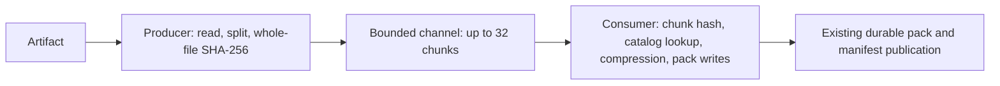

# Bounded import pipeline: public-artifact probe

Sending batches of sixteen chunks between two stages reduced median import time
from 0.248s to 0.191s (23.1%) in this microbenchmark. Total
CPU increased 5.6%. All six paired runs were faster, but this is not a statistical
significance claim or evidence of a Cargo build speedup. The prototype is not
enabled in the shipped filesystem.

| Implementation | Median elapsed (s) | Range (s) | Median user + kernel CPU (s) |
| --- | ---: | ---: | ---: |
| committed baseline | 0.248 | 0.246–0.282 | 0.233 |
| prototype serial | 0.252 | 0.248–0.269 | 0.237 |
| individual chunk messages | 0.220 | 0.214–0.229 | 0.299 |
| sixteen-chunk messages | 0.191 | 0.186–0.195 | 0.246 |

The workload is a 193,988,512-byte public Rust standard-library artifact repeated
sixteen times. Each case starts with a fresh store, seeds the original file, then
imports a copy with one byte changed. The measured import adds one new chunk and
2,206 pack bytes while creating 12,785 extent references. This primarily measures
the path for data already present in the store, rather than novel compression.

The committed baseline and all three prototype modes produced identical import
reports, whole-file hashes, and pack IDs. All 24 cases passed complete store
integrity checks. Tests used Rust 1.97.1 on ARM64 Linux in OrbStack, four CPU quota
and 4 GiB memory, warm caches, and six rounds with reversed mode order.

The producer preserves byte order; chunk boundaries, content hashes and pack
format are unchanged. Batching reduces channel synchronization without adding
more worker threads. The queue contains at most 1 MiB of raw chunk bytes; an
in-flight producer batch and consumer batch can each hold another 512 KiB.
This limit excludes the existing extent list, codecs, database and process memory.

The sequential prototype control measures the abstraction overhead separately
from the committed executable. Individual-chunk messages improve elapsed time
but consume substantially more CPU; batching recovers most of that overhead.

Adoption still needs cancellation and producer-error tests, mounted FUSE lifecycle
checks, and matched x86 Cargo measurements. Clean builds may contend with the
extra producer thread even when an isolated import is faster.

[Reproduce the experiment](../../experiments/import-pipeline/README.md) ·
[Full measurements and source hashes](import-pipeline-probe.json)
